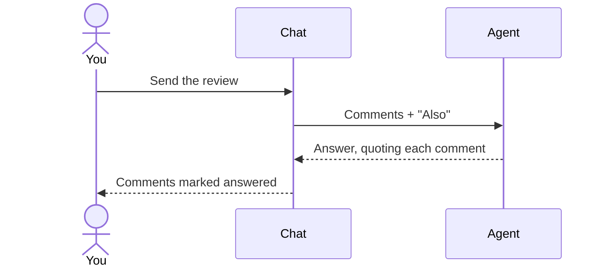

# Diagrams

The person reading your messages sees a ```mermaid block drawn as a diagram, in place. A good
diagram shows in one look what takes a paragraph to say. A bad one is noise, so draw one only
when it helps.

## When to draw one

Draw a diagram for:

- **How parts connect:** modules, services, processes, and what calls or sends to what.
- **The order of calls** between two or more parts: a request, a handshake, a retry.
- **The states something goes through,** and what moves it from one to the next.
- **A decision with branches** that a list makes hard to follow.

Do not draw one for:

- A list, a single step, or one relation. Write a sentence.
- Something the reader did not ask about and does not need to decide anything.
- Code. Show code as code.

One diagram in a message is usually enough. Two is the most.

## How to write it

Use only these three kinds:

- `flowchart TD` (top to bottom) or `flowchart LR` (left to right) for parts and decisions.
  Use `TD` when there are more than four nodes in a row.
- `sequenceDiagram` for the order of calls.
- `stateDiagram-v2` for states.

Keep it small and plain:

- **Twelve nodes at most.** If you need more, draw the part that matters.
- **Short labels:** two to four words. Use the names the code uses (`Chat buffer`, `run loop`).
- **Simple node ids:** one word, no spaces (`Loop`, `Store`). Put the words in the label.
- **Quote labels that have punctuation:** `P["parse(input)"]`, `-->|"retry (3x)"|`.
- **Edge labels of one to three words,** only where the edge is not obvious.
- **Group with `subgraph Name["Title"] ... end`** when parts live in different processes or
  machines.

Never write:

- styles, colors or themes (`style`, `classDef`, `linkStyle`, `%%{init}%%`): the reader's theme
  decides how a diagram looks.
- HTML in labels (`<br/>`, `<b>`): keep labels to one short line.
- `click` lines or links.
- file paths and line numbers in labels: put `path:line` in the text around the diagram, where
  the reader can click it.

## Around it

Write one sentence before the diagram that says what it shows. After it, say what to notice,
if anything is not obvious. The diagram supports the text; the text must still make sense
without it.

## Example

The review goes to the agent as one message, and its answer marks each comment:


