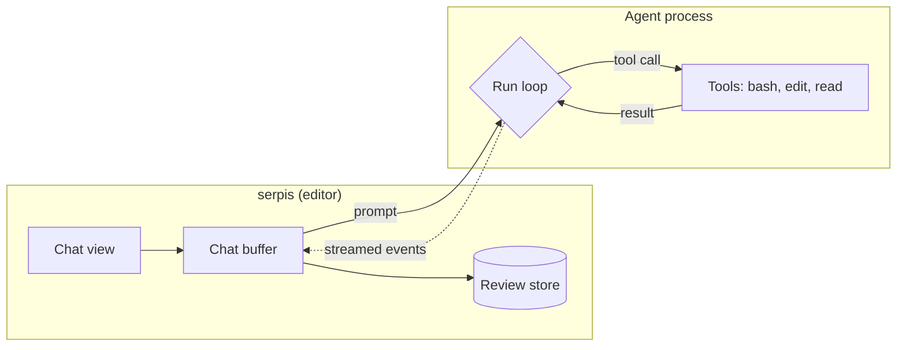
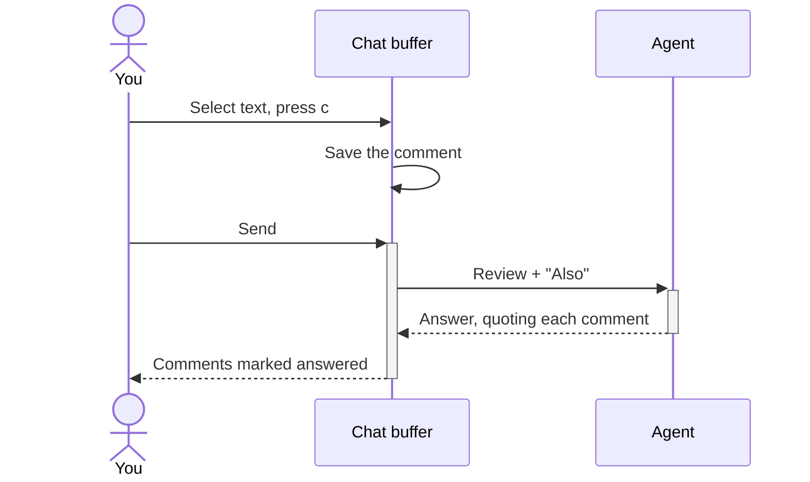
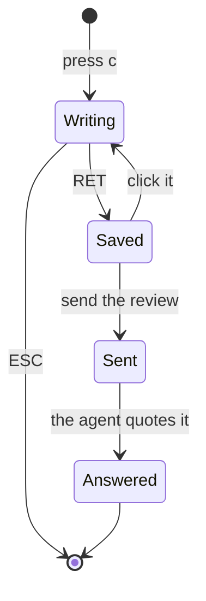

Here is how a review comment travels, from where you write it to the agent's answer.

The pieces, and what talks to what:



What happens when you send the review:



And the states a comment goes through:



A diagram serpis can't draw stays as its source:

```mermaid
this is not a diagram
```
